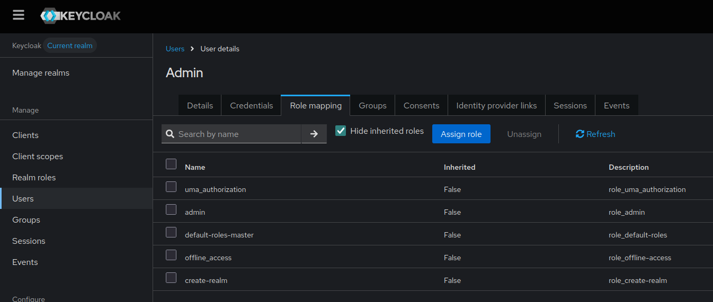

# Установка PostgreSQL
sudo apt update && sudo apt install postgresql postgresql-contrib

# Смена пароля пользователя postgres (установить 1234)
sudo -u postgres psql -c "ALTER USER postgres WITH PASSWORD '1234';"

# Создание базы данных "InfoZhur"
sudo -u postgres createdb InfoZhur

# Выполните SQL-запрос, чтобы PostgreSQL начал генерировать id с правильного значения:
MAX_ID=$(sudo -u postgres psql -d InfoZhur -t -c "SELECT MAX(id) FROM users;")
NEXT_ID=$((MAX_ID + 1))
sudo -u postgres psql -d InfoZhur -c "ALTER SEQUENCE users_id_seq RESTART WITH $NEXT_ID;"

# Выполните SQL-запрос, чтобы PostgreSQL начал генерировать id с правильного значения:
MAX_ID=$(sudo -u postgres psql -d InfoZhur -t -c "SELECT MAX(id) FROM users;")
NEXT_ID=$((MAX_ID + 1))
sudo -u postgres psql -d InfoZhur -c "ALTER SEQUENCE users_id_seq RESTART WITH $NEXT_ID;"

# https://www.w3resource.com/PostgreSQL/snippets/postgresql-keycloak-integration.php
# Подключитесь к PostgreSQL с правами суперпользователя:
sudo -u postgres psql

# Установите PostgreSQL и создайте пользователя/базу для Keycloak:
CREATE USER keycloak WITH PASSWORD 'keycloak';
CREATE DATABASE keycloak OWNER keycloak;

#/ReactDB/keycloak-26.2.4/conf/keycloak.conf
# The database vendor.
db=postgres

# The username of the database user.
db-username=keycloak

# The password of the database user.
db-password=keycloak

# The full database JDBC URL. If not provided, a default URL is set based on the selected database vendor.
db-url=jdbc:postgresql://localhost:5432/keycloak

#keycloak start
./kc.sh start-dev

admin
XH?*iAe4hc#GB4g

Группы пользователей (В keycloak уже добавил, Role Mappings  для каждой группы тоже), как это лучше оформить и всторить в код
Administration
---Moderators (Право на редактирование и удаление комментариев под статьями)
---Administrators (Права модераторов, +право на редактирование статей)
---SEO (Права на все)
Creators (создание и редактирование (своих статей))
Users (обычный пользователь без особых прав)